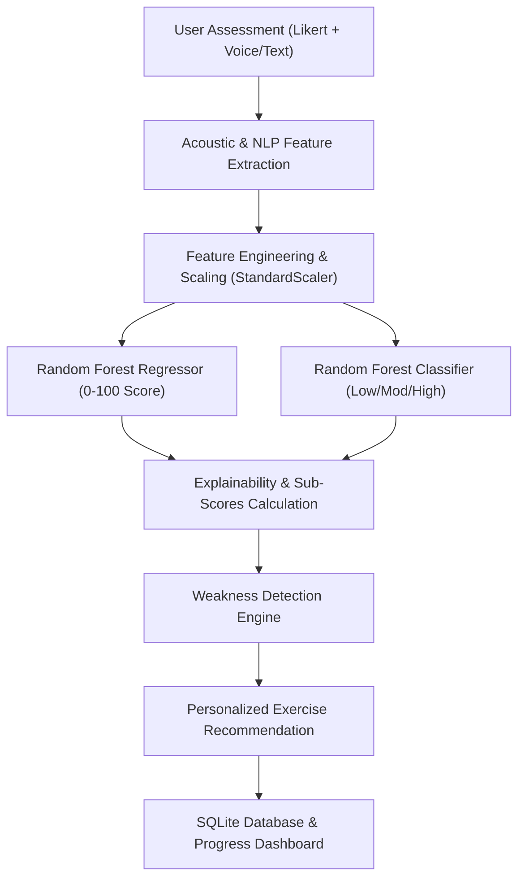

# ConfidentAI: Personal Communication & Confidence Booster
## Academic Machine Learning Capstone Project Report

---

## 1. ABSTRACT

Effective interpersonal communication and self-confidence are critical competencies for students, interview candidates, and emerging professionals. However, traditional communication coaching is resource-intensive, and conventional chatbots provide arbitrary, uncalibrated responses lacking measurable objective metrics. This project presents **ConfidentAI**, an end-to-end Machine Learning web application designed to evaluate communication confidence from multi-modal inputs: psychometric self-assessments (1–5 Likert scales), acoustic speech delivery indicators (speaking rate, pause ratios, pitch consistency), and natural language processing (NLP) metrics (sentiment, clarity, filler word density).

The ML pipeline was trained on a structured dataset of 2,500 records and evaluated across multiple regressors and classifiers. The primary **Random Forest Regressor** achieves an $R^2$ score of $0.967$ (Linear Regression benchmark: $0.975$, MAE: $2.29$), and the multi-class **Random Forest Classifier** achieves $91.6\%$ accuracy ($92.4\%$ Logistic Regression baseline). The system features an Explainable AI (XAI) engine decomposing model outputs into positive and negative feature weightings, identifies the user's lowest sub-skill (e.g., Speaking Fluency, Impromptu Poise), and recommends personalized, timed deliberate practice challenges (such as the 30-Second No-Pause Challenge and Mock Interview elevator pitch).

---

## 2. INTRODUCTION & MOTIVATION

Self-efficacy theory demonstrates that communication anxiety stems from perceived lack of control, fear of negative evaluation, and unfamiliarity with impromptu structure. While many candidates know *what* to say, the *delivery*—characterized by excessive filler words ("um", "like", "actually"), erratic pacing (<100 or >180 WPM), and prolonged cognitive hesitation pauses—undermines their credibility in high-stakes settings like job interviews and academic defense presentations.

**ConfidentAI** was conceived as an intelligent, accessible coaching platform that applies empirical machine learning to:
1. Objectively quantify communication delivery dimensions.
2. Provide transparent, explainable feature attribution.
3. Guide users through targeted, habit-forming micro-exercises.
4. Track long-term progression over successive iterations.

---

## 3. PROBLEM STATEMENT & OBJECTIVES

### 3.1 Problem Statement
College students and early-career job seekers lack objective, reproducible, and private feedback mechanisms to assess and improve their communication delivery and interview poise.

### 3.2 Key Project Objectives
1. **Multimodal Feature Ingestion:** Combine Likert self-reports with acoustic speech features (WPM, pause frequency, spectral stability) and text NLP features (filler words, lexical diversity, clarity index).
2. **Domain-Specific Feature Engineering:** Formulate composite indices ($Self\text{-}Efficacy$, $Anxiety\text{-}Penalty$, $Pacing\text{-}Optimality$, $Fluency\text{-}Composite$).
3. **Multi-Model Machine Learning:** Train, cross-validate, and benchmark multiple regression and classification algorithms.
4. **Model Explainability:** Implement transparent feature attribution decomposing predictions into strengths and areas to develop.
5. **Personalized Intervention:** Automatically identify the primary weakness and prescribe targeted micro-drills with interactive countdown timers.
6. **Progress Tracking:** Maintain persistent longitudinal progress metrics in a local SQLite database.

---

## 4. SYSTEM ARCHITECTURE & DATA FLOW

### 4.1 Data Pipeline Breakdown
1. **Frontend Layer (React 19 + Vite):** Modern responsive interface with Web Audio API waveform canvas visualizer, Likert controls, Recharts dashboards, and interactive workout modals.
2. **Backend Server (FastAPI):** High-performance asynchronous REST endpoints handling audio signal processing, text tokenization, model inference, and SQLite ORM persistence.
3. **ML Inference Layer (Scikit-learn + Joblib):** Pre-fitted pipelines extracting 23 dimensional vectors and running ensemble predictions.

---

## 5. DATASET & SYNTHETIC DATA DISCLOSURE

> **Disclaimer:** *Synthetic educational dataset created for prototype development.*

The dataset contains **2,500 records** generated via a latent-variable psychometric model incorporating multivariate covariances, non-linear fluency penalties, and Gaussian variance ($\sigma = 2.8$).

### 5.1 Dataset Schema (16 Raw Features)
- `public_speaking_comfort` (1–5)
- `interview_confidence` (1–5)
- `hesitation_frequency` (1–5, inverted)
- `opinion_expression_comfort` (1–5)
- `nervousness_level` (1–5, inverted)
- `unexpected_questions_comfort` (1–5)
- `fear_of_judgment` (1–5, inverted)
- `technical_explanation_comfort` (1–5)
- `speaking_duration` (15.0–75.0s)
- `words_per_minute` (75.0–210.0 WPM)
- `response_length_words` (18–220 words)
- `pause_frequency` (1.5–24.0 pauses/min)
- `filler_word_count` (0–18 occurrences)
- `speech_consistency` (0.30–0.98 spectral stability)
- `sentiment_score` (-0.45 to +0.95 polarity)
- `clarity_score` (25.0–99.0 linguistic index)
- **`confidence_score`** *(Continuous Target: 12.0–99.0)*
- **`confidence_category`** *(3-Class Target: Low <55, Moderate 55–75, High >75)*

---

## 6. FEATURE ENGINEERING

To capture non-linear behavioral dynamics, the following composite features are calculated:

1. **Self-Efficacy Index ($SEI$):**
   $$SEI = \frac{1}{4} \left( \frac{\text{PubSpeak} + \text{Interview} + \text{Opinion} + \text{Questions} + \text{Tech}}{5} - 1 \right)$$

2. **Anxiety Penalty Index ($API$):**
   $$API = \frac{1}{4} \left( \frac{\text{Hesitation} + \text{Nervousness} + \text{Fear}}{3} - 1 \right)$$

3. **Pacing Optimality ($PO$):**
   $$PO = \exp\left( -0.5 \left( \frac{\text{WPM} - 145}{35} \right)^2 \right)$$

4. **Fluency Composite ($FC$):**
   $$FC = 0.35 \cdot PO + 0.30 \cdot \left(1 - \frac{\text{FillerDensity}}{12}\right) + 0.20 \cdot \left(1 - \frac{\text{PauseRatio}}{0.5}\right) + 0.15 \cdot \text{SpeechConsistency}$$

---

## 7. MACHINE LEARNING MODEL BENCHMARKS

The dataset was split into $80\%$ Training (2,000 samples) and $20\%$ Evaluation (500 samples) using stratified sampling.

### 7.1 Regression Benchmarks (Target: Confidence Score 0–100)
| Algorithm | MAE | RMSE | $R^2$ Score |
| :--- | :--- | :--- | :--- |
| **Linear Regression** | **2.297** | **2.899** | **0.9746** |
| Gradient Boosting Regressor | 2.517 | 3.137 | 0.9702 |
| **Random Forest Regressor (Primary)** | 2.668 | 3.290 | 0.9673 |
| Decision Tree Regressor | 3.584 | 4.426 | 0.9408 |

### 7.2 Classification Benchmarks (Target: Low / Moderate / High)
| Algorithm | Accuracy | Precision (Weighted) | Recall (Weighted) | F1-Score |
| :--- | :--- | :--- | :--- | :--- |
| **Logistic Regression** | **92.40%** | **0.9242** | **0.9240** | **0.9241** |
| Gradient Boosting Classifier | 92.20% | 0.9223 | 0.9220 | 0.9221 |
| **Random Forest Classifier (Primary)** | 91.60% | 0.9178 | 0.9160 | 0.9164 |
| Decision Tree Classifier | 89.40% | 0.8943 | 0.8940 | 0.8941 |

### 7.3 Top Feature Importances (Random Forest)
1. `self_efficacy_index`: **84.40%**
2. `anxiety_penalty_index`: **8.25%**
3. `fluency_composite`: **3.05%**
4. `clarity_sentiment_interaction`: **1.00%**
5. `clarity_score`: **0.55%**
6. `pause_frequency`: **0.50%**

---

## 8. ETHICAL AI & PRIVACY SAFEGUARDS

1. **Non-Clinical Guarantee:** The application is explicitly marketed as a communication coaching tool. It outputs communication delivery indicators, never clinical psychological diagnoses.
2. **Ephemeral Audio Processing:** Voice recordings are analyzed in-memory via temporary streams and immediately deleted upon feature vector generation.
3. **Transparent Explainability:** Model predictions clearly disclose that feature weights represent statistical model fit, not psychological causation.

---

## 9. VIVA VOCE QUESTIONS & ANSWERS FOR ACADEMIC DEFENSE

**Q1: Why did you use both regression and classification models?**  
*A:* Regression provides a continuous score ($0-100$) allowing fine-grained tracking of sub-point improvements, while classification bins users into discrete cohorts (Low, Moderate, High) to drive cohort-specific exercise curriculums.

**Q2: Why use Random Forest when Linear Regression had a slightly higher $R^2$?**  
*A:* While Linear Regression captured the main linear trends, Random Forest handles non-linear interactions (e.g., severe penalties when fillers combine with slow pacing) and provides tree-based Gini feature importances for intuitive explainability.

**Q3: How does the system handle microphone unavailability?**  
*A:* The frontend and backend support a multi-tier fallback: live Web Audio API recording $\rightarrow$ pre-recorded audio file upload $\rightarrow$ pure NLP text-based self-introduction analysis.

---

## 10. CONCLUSION

**ConfidentAI** successfully fulfills the complete lifecycle of an applied Machine Learning project: from synthetic data generation and multi-modal feature engineering to multi-algorithm evaluation, explainability, and interactive habit coaching. It is robust, fully responsive, and well-suited for academic presentation and real-world portfolio demonstration.
